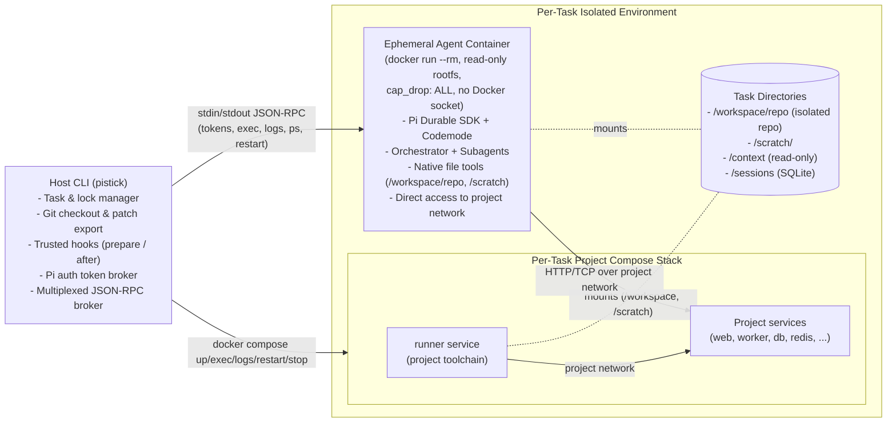

# pi-stick High-Level Plan

## 1. Vision

`pi-stick` is a Linux CLI base platform for running independent, isolated AI tasks against local projects with their full Docker development environment up and running.

- **Full local fidelity**: Every task runs against a real, running instance of the project's Docker Compose stack so agents can verify anything a developer can verify locally (tests, linters, builds, databases, APIs, browsers, logs).
- **Containerized isolation**: Both the project and the agent runtime execute in Docker containers. No Docker socket is ever exposed inside any container.
- **Zero built-in actions by default**: `pi-stick` ships no opinionated workflows (such as PR review). Instead, it provides the primitives for users to author their own actions—from single-agent scripts to multi-agent configurations with parallel workers coordinated by an orchestration agent.
- **Lean host CLI**: The host CLI continues to run directly on Node 24.12+ with **Node built-ins only** (no npm runtime dependencies) and compiles to a standalone Linux binary with Bun.

---

## 2. High-Level Architecture



---

## 3. Core Design Decisions

### 3.1 Clean Pivot from v0.1.0
- Remove hardcoded PR-review commands and assumptions (`pull`, `review`, `review-method.md`, single-model `gpt-6.2-sol` lock-in, GitHub-only requirement, single global execution lock).
- Retain and generalize reusable foundations: project scaffolding (`create project`), Docker Compose recipe validation, Pi Durable SQLite session persistence, detached background worker + plain-text `follow`, `cleanup`, `doctor`, `update`, and Linux binary / npm / installer packaging.

### 3.2 Container Topology & Security Model
- **Ephemeral agent container per task**: Rather than one long-lived `pi-stick` container, each task invocation starts an ephemeral container (`docker run --rm`) from the `pi-stick` image with `--read-only`, `--cap-drop ALL`, `--security-opt no-new-privileges:true`, memory/PID limits, and host UID alignment.
- **Scoped mounts**: Each agent container mounts *only* its own task directories:
  - `/workspace/repo` — the task's isolated repository checkout, at the same path in `runner`
  - `/scratch` — per-agent writable scratch directories (shared with `runner`)
  - `/context` (`ro`) — optional context files written by the action's `prepare` hook
  - `/sessions` — durable SQLite session storage for this run
- **Network access**: The agent container has outbound access to LLM APIs **and** is attached to the task's Docker Compose project network so agents and Codemode scripts can call running project services (`http://service:port`, databases, etc.) directly.
- **Host-brokered container control**: Docker control stays strictly on the host. Agent requests to execute commands in `runner` (or other allowed Compose services), inspect service status/logs, or restart services travel over multiplexed JSON-RPC to the host broker.

### 3.3 Task Workspace, Concurrency & Lifecycle
- **Isolated workspace & stack per task**: Each task creates an isolated copy/worktree of the project repository and starts its own Compose project (`pi-stick-<project>-<run-id>`), leaving the user's development workspace (`projects/<name>/repo`) untouched.
- **Concurrent tasks**: Multiple independent tasks can run simultaneously (across the same or different projects). Locking moves from a global lock file to per-run lock files, with `update` and `cleanup` checking active locks safely.
- **Mutable workspace with clean export**: Tasks may modify files inside their own `/workspace/repo`. On completion, `pi-stick` captures `git diff` / `changes.patch` alongside the run report and artifacts.
- **Container lifecycle (`stop` by default)**:
  - When a run finishes, `pi-stick` runs `docker compose stop` on the task's project stack to release CPU/RAM while preserving workspace files, Docker volumes (dependencies, DB state), reports, patches, and durable SQLite sessions until `pistick cleanup`.
  - Passing `--keep-up` leaves the task stack running for immediate manual inspection.
- **Autonomous execution + `continue`**:
  - Runs execute in a detached background worker with plain-text progress logs (`pistick follow <run-id>`, `pistick resume <run-id>` after interruption).
  - `pistick continue <run-id> "<prompt>"` starts the stopped project stack (`compose start`), launches a new ephemeral agent container against the existing durable SQLite session and workspace, runs the follow-up turn, and stops the stack again.

### 3.4 Actions System
- **Two-tier trusted discovery**:
  1. Project-specific actions: `projects/<project>/actions/<action>/` (highest priority; can override global actions)
  2. Global actions: `$PI_STICK_HOME/actions/<action>/`
  - Action definitions and hooks inside an untrusted `repo/` are **never** loaded or executed automatically.
  - Project notes from `projects/<project>/AGENTS.md` are automatically made available as project context.
- **Declarative format + optional hooks**:
  - Each action is a folder containing `action.json` (validated against a shipped JSON Schema, keeping host CLI zero-dependency), Markdown instruction/rule files (e.g., `orchestrator.md`, `agents/*.md`), and optional host hook scripts (`prepare`, `after`).
  - `pistick create action <name> [--project <project>]` scaffolds a starter action folder.
- **Host hooks (`prepare` / `after`)**:
  - `prepare` runs on the host (where user tools like `gh`, SSH, or issue-tracker CLIs live) before starting the project stack and agent. It can adjust the task checkout (e.g., fetch a PR or branch) and write read-only context files into `$PI_STICK_CONTEXT` (mounted at `/context` in the agent container).
  - `after` runs on the host after task completion with access to the run's report, patch, and metadata for user-defined post-processing.

### 3.5 Multi-Agent Orchestration & Permissions
- **Unified multi-agent runtime** built on Pi Durable conversations within the run's SQLite database, supporting two composable patterns in `action.json`:
  1. **Declarative stages (fan-out / fan-in)**: Run each configured group of agents in parallel. Pass its results to the next group only on success; pass all groups’ results to the final orchestrator.
  2. **Dynamic orchestration**: The orchestrator agent can invoke configured subagents (individually or in parallel batches) via a delegation tool across multiple rounds as it investigates and verifies results.
- **Shared workspace, per-agent permissions**:
  - All agents in a task share the task's `/workspace/repo` and running project stack.
  - Each agent role in `action.json` declares its own permission profile: filesystem mode (`read-only` or `read-write`), allowed tools (`read`, `write`, `edit`, `grep`, `find`, `codemode`, `exec`, `logs`, `ps`, `restart`, `delegate`), and allowed Compose services for `exec`.
  - **`read-only` + per-agent scratch**: `read-only` agents cannot call write/edit tools on `/workspace/repo`, but each agent receives its own writable `/scratch/<agent-id>` directory (mounted in both the agent container and `runner`) to write ad-hoc test scripts, fixtures, or dumps and execute them against the running project. After a `read-only` round finishes, the runtime checks repository cleanliness to catch unintended modifications made via `exec`.
- **Prefixed plain-text progress**: Output from concurrent agents is written to the run's progress stream with clear agent prefixes (e.g., `[orchestrator]`, `[agent:security]`) so `follow`, pipes, and reattached terminals remain readable.

### 3.6 Agent Toolset
- **In-container native tools**: `read`, `write`, `edit`, `grep`, `find`, Pi Codemode, and `delegate` (for orchestrators), plus direct network access to project services.
- **Host-brokered project tools** (multiplexed JSON-RPC with `requestId` for concurrent callers):
  - `exec` — run shell commands in `runner` (or another explicitly permitted Compose service)
  - `logs` — inspect recent logs from project Compose services
  - `ps` — inspect running/health status of project Compose services
  - `restart` — restart a project service (e.g., after code edits when hot-reload is unavailable)

### 3.7 Models & Authentication
- Multi-provider support via the host's local Pi installation (`~/.pi/agent/models-store.json` and `pi auth`).
- Each agent role in `action.json` may specify `provider/model`; omitted values fall back to the action default or global default in `~/.config/pi-stick/settings.json`.
- Before launching a task container, the host resolves all models referenced by the action, requests fresh credentials via `pi auth`, and delivers them strictly over stdin (never in env vars, argv, files, or logs).

---

## 4. Target CLI Surface

```sh
# Workspace & action scaffolding
pistick create project NAME [--repo URL]
pistick create action NAME [--project PROJECT]
pistick actions [--project PROJECT]

# Running & managing tasks
pistick run PROJECT ACTION [--ref REF] [--input KEY=VALUE]... [--keep-up] [PROMPT]
pistick runs [--all]
pistick follow RUN_ID
pistick resume RUN_ID
pistick continue RUN_ID PROMPT [--keep-up]
pistick stop RUN_ID
pistick diff RUN_ID

# Maintenance
pistick cleanup [--dry-run] [--days DAYS]
pistick doctor
pistick update [--yes]
pistick version
```

---

## 5. Implementation Roadmap

### Phase 1: Ephemeral Runtime, Workspace Isolation & Host Broker
*Goal: Replace the v0.1.0 PR-review pipeline with the generic, concurrent container runtime.*
1. Remove hardcoded PR-review commands/files (`pull`, `review`, `review-method.md`, `snapshots.ts` GitHub coupling, `test-file` assumption).
2. Implement per-task isolated checkout/worktree creation and per-run locking (`state/runs/<id>/lock`), enabling concurrent tasks.
3. Update task Compose generation to bind-mount the task's `/workspace` and `/scratch` into the project stack while preserving base recipe safety validation (no host ports, no `privileged`, no external volumes/host mounts).
4. Replace the persistent `pi-stick` Compose service with an ephemeral `docker run --rm` agent container attached to the task's Docker network and scoped mounts, stopping the project stack on completion (`--keep-up` override).
5. Implement multiplexed JSON-RPC between host and agent container for `exec`, `logs`, `ps`, and `restart`.
6. Replace the single hardcoded model with dynamic multi-provider model resolution and credential passing via local `pi auth`.
7. Update `doctor`, `cleanup`, and `update` (image build + offline self-check probe) for the new ephemeral container architecture.

### Phase 2: Actions System, Hooks & Task Lifecycle CLI
*Goal: Enable users to create and run single-agent custom actions end-to-end.*
1. Define the `action.json` manifest specification and JSON Schema (inputs, defaults, hooks, agent definitions, permissions).
2. Implement two-tier action discovery (`projects/<project>/actions/` overriding `$PI_STICK_HOME/actions/`), `pistick actions`, and `pistick create action`.
3. Implement trusted host hooks (`prepare` with `/context:ro` output and `after` post-processing).
4. Build the generic container entrypoint (`agent-runtime.ts`) with native file tools (`read`, `write`, `edit`, `grep`, `find`), Codemode, and host-brokered tools.
5. Implement `run`, `runs`, `follow`, `resume`, `continue`, `stop`, and `diff`, plus automatic `changes.patch` and `report.md` artifact generation.

### Phase 3: Multi-Agent Orchestration & Permission Enforcement
*Goal: Support parallel subagents, orchestrator synthesis, and safe shared-workspace concurrency.*
1. Implement per-agent permission enforcement (`read-only` vs `read-write`, tool allowlists, allowed `exec` services), per-agent `/scratch/<agent-id>` directories, and post-round git cleanliness checks for `read-only` agents.
2. Implement declarative static stages (parallel fan-out -> orchestrator synthesis) on Pi Durable.
3. Implement dynamic orchestration via a `delegate` / `run_agents` tool allowing orchestrators to spawn configured subagents in parallel across multiple rounds.
4. Add prefixed plain-text progress streaming (`[orchestrator]`, `[agent:<name>]`) and persist per-agent outputs alongside the final report.

### Phase 4: Template, Docs, Packaging & Verification
*Goal: Harden everything for release.*
1. Update `project-template/` for the general local-dev workflow (remove review-only scaffolding, document service setup and `AGENTS.md`).
2. Update `scripts/stage-release.sh`, `scripts/install.sh`, `scripts/pack-npm.sh`, `scripts/build-linux.sh`, `README.md`, and `AGENTS.md`.
3. Expand `test/cli.test.ts` to cover concurrent runs, action discovery/overrides, hooks, permission boundaries, `continue`, and multi-agent fan-out/delegation with offline faux-provider fixtures.

---

## 6. Explicit Non-Goals

- Shipping built-in opinionated actions (such as PR review) out of the box.
- Exposing `/var/run/docker.sock` or a Docker API proxy inside agent or project containers.
- Automatically loading or executing action configs or hooks from untrusted repository trees (`repo/`).
- Building a web UI, always-on webhook daemon, or remote multi-tenant server in this phase.
